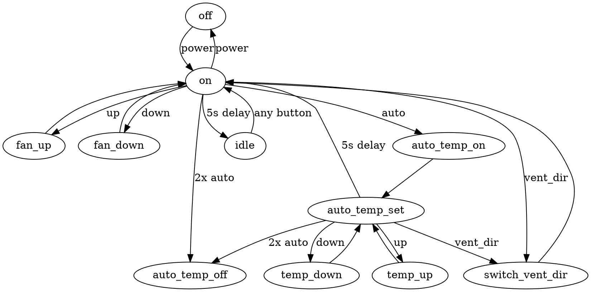

# Design

## Goal

A Home Assistant custom integration that controls a Vornado Transom fan over IR, sending commands through an existing `infrared` emitter entity (HA 2026.11.0+).

## Background

- The `infrared` integration is a building block. It exposes emitter/receiver entities, backed by adapters such as ESPHome or SMLIGHT SLZB.
- Infrared entities have no on/off state. An emitter's state is the timestamp of the last command sent.
- IR is one-way. The fan reports nothing back, so all fan state is assumed.

## Device facts (from the Transom use & care guide)

- Remote buttons: Power, Up, Down, Direct/Exhaust, Auto. Up/Down are the same physical buttons for speed and temperature: they adjust the setpoint only during the 5 s setpoint window that follows an Auto press, and the fan speed otherwise.
- Power is a single toggle button.
- Four speeds: 1 Low, 2 Medium, 3 High, 4 Turbo. Speed is changed with relative up/down buttons, so there is no way to jump to a speed.
- Direct/Exhaust is a single toggle button.
- Auto mode is a thermostat. Setpoint range is 60-90 °F. The setpoint persists across Auto off/on and power off/on. Turning Auto off takes two presses of the Auto button on the remote. The guide also says "single press of the Auto button, when AUTO MODE is activated, will change display from room temp back to SET TEMP", so Auto is not a plain toggle.
- On first plug-in the unit starts in Direct mode, then remembers its settings across power on/off.
- The guide gives no IR protocol or codes. Power loss and manual panel use are invisible to HA.

## Control state machine

Consequences for the integration:

- Changing the setpoint takes Auto, then Up/Down within 5 s. Changing the speed takes Up/Down outside that window.
- The integration must track the 5 s window (a timer) so it knows what Up/Down will do. Commands sent in quick succession must account for it.
- After 5 s idle the display dims, and any button wakes the unit. The waking press only wakes it and has no other effect.
- After the 5 s setpoint window ends, Auto stays active (thermostat mode). Each Up/Down press inside the window restarts the 5 s timer.
- Deactivating Auto takes two Auto presses within 1 s of each other.
- Because a waking press has no effect, and the integration only knows when it sent a command (not when the blaster played it), it throttles sends to one per configurable interval (default 5 s) and starts every send to a running unit with a wake press.

## IR signals

Captured codes and their verification status are in `signals.md`.

## Functional requirements

1. Config flow (UI setup) that asks the user to pick an existing infrared emitter entity.
2. A `fan` entity per Transom: on/off and speed (4 steps).
3. Setting a speed sends the right number of Up/Down presses from the assumed current speed, outside the setpoint window.
4. Direct/Exhaust control.
5. Thermostat control: Auto on/off and setpoint (60-90 °F), using the Auto-then-Up/Down sequence from the state machine. Exposed as a `select` (Mode: Auto or Manual) and a `number` (setpoint). The unit reports no measured temperature, so users who want HA to manage the temperature use HA's generic thermostat with their own thermometer and Mode set to Manual.
6. The integration is the only IR transmitter. It does not try to detect rogue signals from the physical remote.
7. State is dead-reckoned (assumed) from the commands the integration has sent, and is restored across HA restarts.
8. The dead-reckoned state is fully visible to the user: power, speed, vent direction, Auto active, setpoint, whether the unit is assumed idle and the time of the last command. This is enough for the user to see what to change on the real fan to match.
9. Manual resync: the user can set the assumed state to match the real fan without sending IR (for example via entities or an action). Nothing is sent to the fan when resyncing.
10. If the selected emitter is unavailable, the entities are unavailable.
11. Multiple fans, each with its own emitter, are allowed.
12. Minimum HA version is 2026.11.0.
13. The number of frames sent per press is configurable (default 5, see `signals.md`).

## Non-functional requirements

- Distribution as a custom integration under `custom_components/`, through Home Assistant's Marketplace.
- Tests use `pytest-homeassistant`, HA's official test package.
- Tests cover the config flow, the entity behavior, and the exact IR commands emitted. Expected IR codes are hard-coded in the tests.

## Out of scope

- Learning or capturing IR codes in the UI.
- Controlling any device other than the Transom.
- Contributing to HA core.
- Detecting or syncing to presses on the physical remote or panel (no receiver support).

## HA infrared API (2026.11.0)

- Consumer entities subclass `infrared.InfraredEmitterConsumerEntity`, set `_infrared_emitter_entity_id`, and call `self._send_command(command)`. Availability tracking of the emitter entity is built in.
- A command is an `infrared.InfraredCommand` (`infrared_protocols.commands.Command`): `modulation`, `repeat_count`, and `get_raw_timings()` returning signed µs timings. We can subclass it to emit any timing sequence, including multi-press sequences with our own pauses.
- `infrared_protocols.commands.symphony.SymphonyCommand(custom_code=3, control_word=...)` already encodes Transom presses. Its `get_raw_timings()` includes all repeat frames (`repeat_count + 1` frames).
- The MQTT emitter (used by Zigbee2MQTT) publishes `{"timings", "modulation", "repeat_count"}`. Z2M encodes the timings literal-only (uncompressed, see `signals.md`) and sets the Tuya envelope's `num` to `1 + repeat_count`. The UFO-R11 ignores `num` (verified), so `repeat_count` has no effect on playback there. Other blasters may differ, so our commands still report `repeat_count=0` with all frames in the timings.
- Payloads must respect the blaster's ~288-318 timing playback limit (see `signals.md`). The integration cannot see the emitter backend, so this limit is a configurable option with a conservative default.

## Decisions

- Domain: `vornado_transom_infrared`. An existing custom integration (Alexa-based) already installs to `custom_components/vornado_transom`.
- Thermostat control is included, as a `select` (Mode) and a `number` (setpoint), not a `climate` entity.
- Out-of-sync recovery is manual, with the assumed state exposed to the user.
- 5 frames per press (default of the configurable frame count). Single presses can use `SymphonyCommand(custom_code=3, control_word=..., repeat_count=4)`. Multi-press sequences need a custom `InfraredCommand` that concatenates press timings with 65 ms pauses.
- Sequences longer than the playback limit are split across payloads (2 presses per payload at 5 frames). Verified: back-to-back split payloads arrive ~2.2 s apart, inside the 5 s setpoint window.
- The integration holds two states: the target the user asked for and the assumed state of the unit. Sending moves the assumed state toward the target.
- **Setpoint change while Auto is off.** Store the target setpoint and send nothing. When Auto is next turned on, send Auto, then the Up/Down presses that move the unit's setpoint to the target.
- **Changes while power is off.** Store target direction, Auto and setpoint and send nothing. When power is next turned on, send Power, then the presses that move the unit from its remembered settings to the targets. Setting a speed on an off fan turns it on.
- **Throttling and waking.** Sends are throttled to at most one per configurable interval (default 5 s). Changes requested during the interval are coalesced and sent when it ends. Every send while the unit is on starts with a wake press, because the unit is always assumed to be idle. The parts of one split send are not separate sends, since they arrive ~2.2 s apart while the unit is awake.
- **Speed change inside the setpoint window.** Wait until the setpoint window has passed before sending speed presses, plus a transfer lag margin.
- **Resync.** The action `vornado_transom_infrared.set_assumed_state` targets the fan entity, takes optional fields (power, speed, direction, auto, setpoint) and changes state without sending IR. Diagnostic entities show the last command time and assumed idle.
